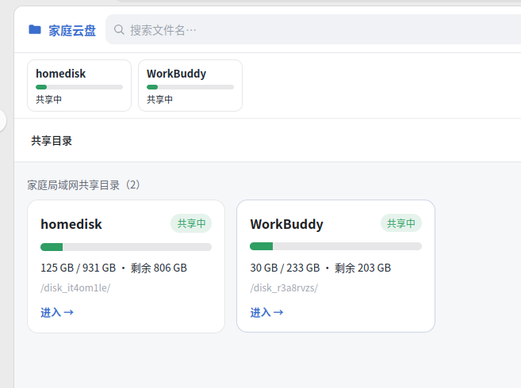
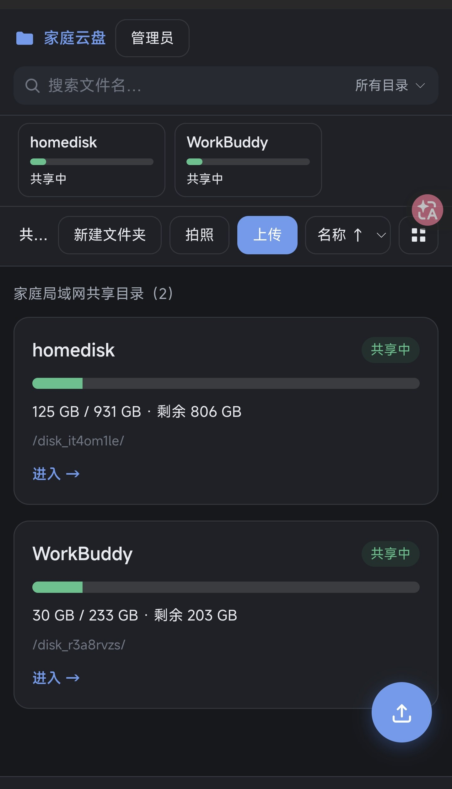

# HomeCloud · 家庭局域网私有云盘

> 一台电脑的硬盘，家里所有设备（手机 / 平板 / 电脑）都能通过浏览器直接访问、上传、下载、整理文件。自带图形界面与初始化向导，无需 Docker，纯 Node.js 实现。

## 界面一览

**电脑端（浅色主题）**——共享目录卡片、容量条、网格视图：



**手机端（深色主题）**——自动跟随系统深浅色，多共享目录切换、拍照上传：



**首次初始化向导**——全程图形化，不用在终端敲一条命令：


---

## 一、项目简介

HomeCloud 是一个**轻量的家庭局域网网盘**。把它跑在家里的某台电脑上，你选定的文件夹 / 磁盘就成了"私有云"——只要设备连着同一个 WiFi / 局域网，打开浏览器输入地址就能像用网盘一样浏览、上传、下载、管理文件。

- **零外部依赖**：不需要 Docker、不需要数据库、不需要 Nginx。只依赖 5 个 npm 包。
- **图形化初始化向导**：首次运行自动进入向导页面，鼠标点选共享目录、端口、密码即可完成设置并自动启动服务，无需手敲命令。
- **多磁盘共享**：除了系统盘，还能自动识别并添加机器上其他磁盘（机械硬盘、外接硬盘、U 盘等），可同时共享多块磁盘或任意文件夹。
- **跨平台**：同一套代码同时支持 Linux 与 Windows（路径、端口检测、磁盘枚举、启动脚本均已适配）。
- **安全边界**：默认只允许局域网 IP 访问；破坏性操作（删除 / 重命名 / 移动 / 大文件上传）需要管理员密码；路径做了严格的越权防护。

> 设计定位是**家庭内部使用**，请不要把端口映射到公网，也不要做内网穿透。

---

## 二、功能特性

| 功能 | 说明 |
|---|---|
| 🧙 图形化初始化向导 | 首次运行自动打开向导：点选共享目录（内置目录浏览器）→ 设置端口（实时冲突检测）→ 设密码 → 一键完成并自动启动 |
| 📂 文件夹浏览 | 网格 / 列表双视图，面包屑导航，移动端「← 返回上一级」按钮 |
| ⬆️ 上传 | 多文件、拖拽、手机拍照上传；分片传输 + 进度条 + 断点续传 |
| ⬇️ 下载 | 单文件断点续传（支持视频拖动进度条）；多选打包成 ZIP 下载 |
| 🔍 搜索 | 文件名模糊搜索，所有目录 / 当前目录范围可选，后台索引毫秒级响应 |
| 🗂️ 文件夹管理 | 新建、重命名、移动（弹窗选目录 + 拖拽 + 剪切粘贴）、批量删除 |
| 💽 多磁盘共享 | 可同时共享多块磁盘 / 任意文件夹；管理界面支持启用 / 停用 / 改名 / 移除 |
| 🔎 磁盘自动发现 | 服务端直接读取系统挂载表（Linux `/proc/mounts`，Windows 枚举盘符），不依赖 `lsblk`；区分「系统盘上的分区」与「独立 / 外接磁盘」；目录浏览器根目录一键直达所有磁盘 |
| 🔁 换机 / 换盘自动重认 | 每个共享目录写入隐藏标记文件，磁盘换挂载点后「重新扫描」即可自动重新关联 |
| ⚔️ 端口冲突处理 | 端口被旧的本服务占用 → 自动停止旧进程；被其他程序占用 → 明确提示更换端口，绝不误杀 |
| 🔐 权限 | 访客默认可浏览 + 上传（≤1GB 免密）；破坏性操作需管理员密码 |
| 🌗 深浅色主题 | 自动跟随系统深色 / 浅色模式 |
| 📱 移动端适配 | 手机 / 平板浏览器自适应布局 |
| 🖼️ 图片缩略图 | 网格视图自动生成缩略图（可选，缺失也不影响其他功能） |
| 💾 容量展示 | 实时显示每个共享目录的已用 / 剩余空间 |

---

## 三、快速开始

> 前置条件：安装 [Node.js LTS](https://nodejs.org)（Windows 安装时勾选 **Add to PATH**）。

### Linux（Ubuntu / Debian 等）

```bash
# 1. 安装依赖（仅首次）
cd homecloud/app && npm install

# 2. 启动初始化向导
bash setup.sh        # 自动启动服务并打开浏览器进入向导

# 3. 在浏览器里完成设置（选目录 → 端口 → 密码），
#    完成后会在项目根目录生成 start.sh，以后启动只需：
bash start.sh
```

也可以用一键安装脚本（挂载 + 依赖 + systemd 开机自启）：`sudo bash scripts/install.sh`。

### Windows

1. 双击 **`scripts\windows\setup-homecloud.bat`**（首次初始化向导，会自动装依赖）
2. 按窗口打印的地址在浏览器打开向导，点选要共享的目录（D:\、E:\ 等所有盘符都可以）、设置端口和密码
3. 完成后项目根目录会生成 **`start.bat`**，以后**双击它**即可启动
4. （可选，开机自启 + 后台运行）右键 `scripts\windows\install-service.ps1` → **"使用 PowerShell 运行"**（建议管理员身份）

> 详细说明见 [`docs/05-Windows部署指南.md`](docs/05-Windows部署指南.md)。

### 初始化向导做了什么

- **选择共享目录**：内置目录浏览器，点「💽 磁盘」可直达所有已挂载磁盘（含机械硬盘），可整盘共享，也可展开只共享某个子文件夹；支持添加多个。
- **设置访问端口**：输入即实时检测——被本服务旧进程占用会在完成时自动停止；被其他程序占用会提示更换端口号。
- **管理员与访问设置**：管理员密码、访客单文件上传上限（GB）、是否仅限局域网访问。
- 点击「完成设置并启动」：写入配置 → 服务以选定端口自动重启 → 页面展示局域网访问地址。

> 端口刻意**不写入** `config.json`，只保存在生成的启动器（`start.sh` / `start.bat`）里——改端口只需改启动器里那一行。

---

## 四、项目结构

```
homecloud/                          # 仓库根目录
├── README.md                       # 本文件
├── LICENSE                         # MIT 许可证
├── .gitignore                      # 排除依赖 / 数据 / 日志 / 运行时
├── setup.sh                        # Linux：启动首次初始化向导（已初始化时提示用 start.sh）
├── start.sh                        # 初始化后自动生成（端口在这里修改）
├── app/                            # 服务端 + 前端源码（核心交付）
│   ├── server.js                   # 服务入口（含向导模式 / 端口冲突处理）
│   ├── package.json                # 依赖与脚本
│   ├── public/                     # 纯前端（无需构建）
│   │   ├── index.html / style.css / app.js
│   │   └── setup.html              # 初始化向导页面
│   └── src/
│       ├── lib/                    # 基础库（路径安全 / 配置 / 认证 / 卷检测 / 端口工具 / 索引…）
│       └── routes/                 # 各 API 路由（files / upload / manage / search / auth / shares / setup）
├── docs/                           # 设计文档与使用说明（含 screenshots/ 截图）
└── scripts/
    ├── install.sh                  # Linux：一键安装（依赖 + systemd 自启）
    ├── mount-disk.sh               # Linux：挂载 NTFS 磁盘到 /mnt/homedisk
    └── windows/
        ├── setup-homecloud.bat     # Windows：首次初始化向导入口
        ├── start-homecloud.bat     # Windows：日常启动（自动调用根目录 start.bat）
        ├── install-service.ps1     # Windows：注册开机自启 + 后台运行
        └── uninstall-service.ps1   # Windows：取消开机自启
```

---

## 五、核心模块职责

> 更详细的架构说明见 [`docs/04-技术架构.md`](docs/04-技术架构.md)。

| 模块 | 职责 |
|---|---|
| `server.js` | 入口：向导模式判定、端口冲突处理（自家服务自动停止 / 异程序占用明确报错）、挂载路由、打印局域网地址、启动后台索引 |
| `src/lib/pathGuard.js` | **最关键的防护**：路径归一化 → 拼接 → `realpath` → 前缀比对，防 `../` 穿越、URL 编码绕过、符号链接逃逸；文件名清洗（含 Windows 保留名）、同名自动重命名；多共享目录路由与磁盘身份标记 |
| `src/lib/volumes.js` | 磁盘 / 卷检测：Linux 解析 `/proc/mounts`（不依赖 `lsblk`）、macOS 用 `mount`、Windows 枚举盘符；过滤伪文件系统与系统关键挂载点；区分系统盘分区与独立磁盘 |
| `src/lib/portutils.js` | 端口占用检测与进程识别（Linux `ss` + `/proc/<pid>/cmdline`，Windows `netstat` + `wmic`），只自动结束本服务进程 |
| `src/lib/config.js` | 配置管理：默认值 + 环境变量覆盖 + scrypt 密码哈希 + 多共享目录配置读写 |
| `src/lib/auth.js` | 管理员认证与会话：scrypt 校验、httpOnly Cookie、失败限流、局域网 IP 判定 |
| `src/lib/indexer.js` | 后台全文索引：启动全量扫描、内存缓存 + 落盘、定时增量、搜索优先走索引 |
| `src/routes/setup.js` | 首次初始化向导 API（仅本机可访问、完成后自动重启为正式服务并生成启动器） |
| `src/routes/shares.js` | 共享目录管理：列表 / 候选磁盘发现 / 添加 / 启停 / 改名 / 移除 / 重扫描 |
| `src/routes/files.js` | 目录列表、容量（`statfs`）、单文件下载（Range 断点续传）、ZIP 打包下载、图片缩略图 |
| `src/routes/upload.js` | 分片上传（init→chunk→done），访客上限权限闸门，`.hcpart` 临时文件与超时清理 |
| `src/routes/manage.js` | 文件夹管理：新建 / 重命名 / 移动 / 删除 / 目录树 / 可选回收站 |
| `public/setup.html` | 初始化向导前端（目录浏览器 + 端口实时检测 + 密码设置） |
| `public/` 其余 | 前端：纯浏览器 JS，无需打包构建；双视图、多磁盘切换、多选、拖拽移动、搜索、深色模式、移动端适配 |

---

## 六、依赖清单

运行时仅 5 个 npm 包（`app/package.json`）：

| 依赖 | 用途 |
|---|---|
| `express` | HTTP 服务与路由 |
| `sharp` | 图片缩略图生成（原生模块，缺省时自动降级） |
| `archiver` | 多选文件流式打包成 ZIP |
| `cookie-parser` | 解析管理员会话 Cookie |
| `mime-types` | 下载时推断文件 MIME 类型 |

> 前端**没有任何 npm 依赖**，不引入框架、不需要 `npm run build`。

---

## 七、配置说明

配置持久化在 `app/data/config.json`，可用环境变量临时覆盖（便于部署脚本一次性设定）。

| 配置项 | 默认值 | 说明 |
|---|---|---|
| `disks` | 向导中配置 | 共享目录列表（支持多块磁盘 / 任意文件夹），一般由向导或管理界面维护 |
| `adminPasswordHash` | 向导中设置 | 管理员密码哈希（scrypt）；命令行改密见下 |
| `guestUploadMaxBytes` | `1073741824`（1GB） | 访客免密上传的单文件上限；`0` 表示禁止访客上传；环境变量 `HOMECLOUD_UPLOAD_LIMIT` |
| `lanOnly` | `true` | 仅允许局域网 IP 访问（家庭网盘的基本安全边界） |
| `sessionHours` | `8` | 管理员登录有效期（小时） |
| `indexIntervalMinutes` | `30` | 全盘索引刷新间隔（分钟） |
| `trashDir` | `''`（直接删除） | 设为某目录后，删除改为移入回收站，误删可救；环境变量 `HOMECLOUD_TRASH` |
| 端口 | `8080` | **不在 config.json 中**，由启动器 `start.sh` / `start.bat` 的 `HOMECLOUD_PORT` 管理 |

**常用命令**

```bash
# 修改 / 设置管理员密码（在 app 目录下执行）
node server.js --set-password 你的密码
```

---

## 八、常见问题（FAQ）

**Q1：手机 / 其他设备怎么访问？**
用这台电脑的**局域网 IP** 访问，例如 `http://192.168.1.14:8080`。初始化完成后向导会直接把可用的局域网地址列出来。
- Windows 查 IP：命令行 `ipconfig`，看「IPv4 地址」
- Linux 查 IP：`hostname -I` 或 `ip a`

**Q2：怎么把机械硬盘也共享出去？**
打开网页 → 点右上角「管理员」输密码解锁 → 点「管理共享目录」：上方会列出检测到、尚未添加的其他磁盘（标注"独立 / 外接磁盘"），点「添加」即整盘共享；或用目录浏览器展开到某个子文件夹后「共享当前目录」。

**Q3：访客能随便上传吗？**
默认可以上传，但**单个文件超过 1GB 需要管理员密码**。上限在初始化向导里设置，之后也可改 `guestUploadMaxBytes`（`0` 为禁止访客上传）。

**Q4：删除 / 移动某些文件提示失败？**
- **Windows**：目标目录可能保留了旧系统的只读权限（如 `WindowsApps`）。以管理员身份运行启动脚本，或参考 Windows 部署指南处理 NTFS 权限。
- **Linux**：确认共享目录是用 `scripts/mount-disk.sh` 挂载的（带 `noacsrules`，忽略 Windows ACL）。

**Q5：端口被占用 / 想换端口？**
服务对端口冲突有专门处理：占用者若是**旧的 HomeCloud 进程会自动停止**；若是**其他程序**会明确提示并列出进程信息，请换一个端口。改端口的正规方式：编辑启动器（Linux `start.sh` / Windows `start.bat`）里的 `HOMECLOUD_PORT`，重新运行。

**Q6：换了机器 / 磁盘挂载点变了，共享目录找不到了？**
每个共享目录内写有隐藏标记文件，在管理界面点「重新扫描」即可按标记自动重新关联到新挂载点。

**Q7：图片缩略图不显示？**
说明 `sharp`（原生模块）未加载，这**只影响网格视图的缩略图**，文件浏览 / 上传 / 下载 / 搜索不受影响。重新 `npm install` 即可。

**Q8：能映射到公网 / 做内网穿透吗？**
**不建议**。本系统设计为家庭局域网内部使用，安全模型只覆盖局域网边界。不要做端口映射或内网穿透。

**Q9：Windows 开机自启后没生效？**
- 确认以管理员运行过 `install-service.ps1`；
- 任务计划程序里查看 `HomeCloudLAN` 任务的状态；
- 若 PowerShell 提示禁止脚本，先执行 `Set-ExecutionPolicy RemoteSigned -Scope CurrentUser`。

---

## 九、安全声明

- 默认仅接受局域网私有网段（`10.x` / `192.168.x` / `172.16-31.x` / `127.x` / `169.254.x`）的请求。
- 初始化向导**仅限服务器本机（127.0.0.1）访问**，完成设置后自动关闭。
- 路径访问经过 `realpath` + 前缀比对，杜绝 `../` 穿越、URL 编码绕过、符号链接逃逸。
- 破坏性操作一律要求管理员密码；会话用服务端 Cookie，登出即失效。
- 请在可信的家庭网络内使用，不要暴露到公网。

---

## 许可证

[MIT](LICENSE) © 2026 HomeCloud contributors
