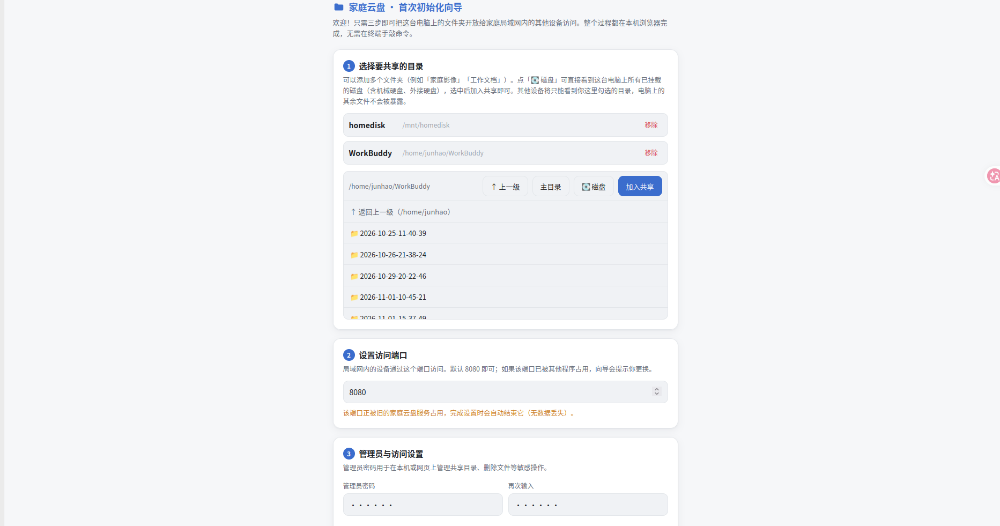
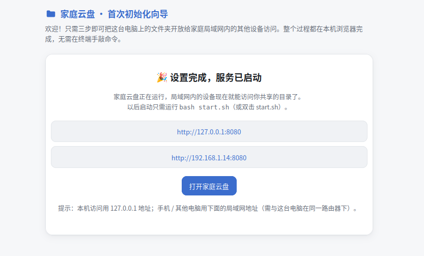
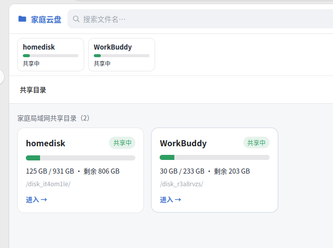
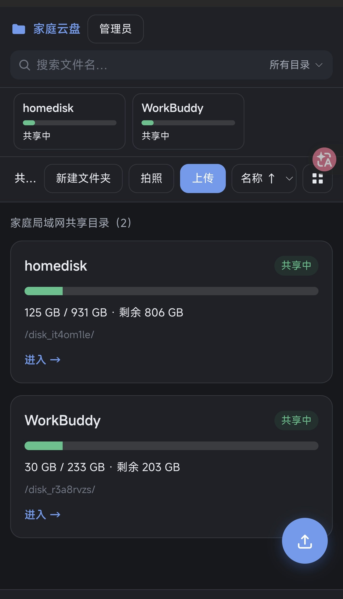

# HomeCloud 家庭云盘 · 使用说明

## 一、安装与首次初始化（在这台电脑上做一次）

### 推荐方式：图形化初始化向导

```bash
cd homecloud
bash setup.sh        # 启动向导并自动打开浏览器
```

然后在浏览器里按提示完成三步（全程鼠标点选，无需敲命令）：



1. **选择要共享的目录** —— 点「💽 磁盘」直达所有已挂载磁盘（含机械硬盘），整盘共享或展开选子文件夹均可，可添加多个
2. **设置访问端口** —— 输入即实时检测；被旧的本服务占用会自动停止，被其他程序占用会提示换端口
3. **管理员与访问设置** —— 密码、访客上传上限、是否仅限局域网

点「完成设置并启动」后，服务自动以选定端口重启，页面展示访问地址：



以后启动只需：

```bash
bash start.sh        # 端口在这里改：编辑 HOMECLOUD_PORT 一行
```

> Windows 用户见 [05-Windows部署指南.md](05-Windows部署指南.md)：双击 `scripts\windows\setup-homecloud.bat` 完成同样的向导，之后双击根目录 `start.bat` 启动。

### 备选方式：一键安装（systemd 开机自启）

在终端里执行（需要输入你的开机密码）：

```bash
sudo bash scripts/install.sh
```

安装程序会依次完成：挂载硬盘并写入 fstab → 准备 Node.js 运行时 → 程序装到 `/opt/homecloud` → 设置管理员密码 → 注册 systemd 开机自启。

> 只想挂载硬盘、不装服务，可以单独运行：`sudo bash scripts/mount-disk.sh`
> 脚本可以反复运行，已完成的步骤会自动跳过。

## 二、家人怎么用

在任何连着家里 WiFi 的设备（手机 / 平板 / 电脑 / 电视）上打开浏览器，输入初始化完成时展示的局域网地址（形如 `http://192.168.1.14:8080`）。

建议让家人在手机浏览器里「添加到主屏幕」，之后点图标就能直接打开，跟 App 一样。

**不需要安装任何软件，也不需要登录账号。**

### 界面长什么样

电脑端（浅色主题）与手机端（自动跟随系统深色模式）：





### 能做什么

| 想做的事 | 怎么操作 |
|---|---|
| 看文件 | 打开就看到共享目录内容，顶部可在多个共享目录间切换，点文件夹进入，点文件直接下载 |
| 传照片/视频 | 点右下角圆形按钮（手机）或右上角「上传」（电脑）；手机上还能点「拍照」直接拍了传 |
| 传整个文件夹 | 电脑端把文件夹直接拖到网页里 |
| 找文件 | 顶部搜索框输入关键词，可选「所有目录」或「当前目录」 |
| 按类型找 | 顶部点「图片 / 视频 / 音频 / 文档 / 压缩包」 |
| 新建文件夹 | 点「新建文件夹」 |
| 打包下载 | 勾选多个文件或文件夹 → 点「下载」，会自动打包成 ZIP |

### 需要密码的操作

删除、重命名、移动、剪切粘贴，以及**上传单个超过设定上限（默认 1GB）的文件**，会弹出密码框。
输入管理员密码后操作立即继续，不用重来一遍。解锁状态保持 8 小时，之后自动失效。

## 二·五、把其他磁盘也加进来（多磁盘共享）

除了系统盘，机器上已挂载的其他磁盘（机械硬盘、外接硬盘、U 盘等）都可以一并作为共享目录加入。

**图形化操作：**

1. 打开家庭云盘页面 → 点右上角「管理员」输入密码解锁。
2. 点「管理共享目录」。
3. 上方列表会列出**这台电脑上检测到、尚未添加的其他磁盘 / 分区**，并标注是「独立 / 外接磁盘」还是「系统盘上的分区」：
   - 点「添加」＝把整块磁盘加入共享；
   - 想只共享盘里的某个子文件夹，用下方目录浏览器展开后再点「共享当前目录」。
4. 目录浏览器里点「💽 磁盘」可回到根目录，查看全部已挂载磁盘。

**说明：**

- 磁盘检测由服务端读取系统挂载表完成（Linux 解析 `/proc/mounts`，Windows 枚举盘符），不依赖 `lsblk`，所以无论机械硬盘挂在哪里（`/mnt`、`/media`、`/run/media` 或自定义路径）都能被发现。
- 每块共享目录内会写入一个隐藏标记文件，因此换机、换成新盘或换挂载点后，用「重新扫描」即可自动重新关联。
- 已加入的目录不会重复出现在候选列表里；在已共享列表里可以停用、改名或移除（移除不会删除磁盘上的文件）。
- 如果某块盘当前没挂载，候选列表会提示「该设备尚未挂载」，请先在系统里挂载（例如 `sudo bash ~/homecloud/scripts/mount-disk.sh`）。

## 三、管理员常用命令

```bash
# 查看服务状态
sudo systemctl status homecloud

# 重启 / 停止 / 启动
sudo systemctl restart homecloud
sudo systemctl stop homecloud
sudo systemctl start homecloud

# 查看实时日志
tail -f /opt/homecloud/logs/homecloud.log

# 修改管理员密码（用内置的 node，不依赖系统里有没有装 node）
sudo -u $USER /opt/homecloud/runtime/node /opt/homecloud/server.js --set-password 新密码
```

> 服务用的是 `/opt/homecloud/runtime/node` 这份内置的 Node.js，
> 所以卸载系统 node、卸掉 nvm 都不会影响服务运行。

## 四、改配置

配置文件：`app/data/config.json`（一键安装方式则在 `/opt/homecloud/data/config.json`）

```json
{
  "disks": [
    { "id": "disk_xxxx", "name": "homedisk", "path": "/mnt/homedisk", "enabled": true }
  ],
  "guestUploadMaxBytes": 1073741824,
  "sessionHours": 8,
  "indexIntervalMinutes": 30,
  "trashDir": "",
  "lanOnly": true
}
```

| 配置项 | 说明 |
|---|---|
| `disks` | 共享目录列表（支持多块磁盘 / 任意文件夹），**推荐用网页「管理共享目录」图形化维护**，不必手改 |
| `guestUploadMaxBytes` | 免密码上传的单文件上限，默认 1073741824 即 1GB |
| `sessionHours` | 管理员解锁状态保持时长 |
| `trashDir` | 留空 = 直接删除；填一个路径（如 `/mnt/homedisk/.回收站`）= 删除时移入该目录，误删可救 |
| `lanOnly` | 只放行局域网 IP，建议保持 true |
| 端口 | **不在 config.json 里**，由启动器 `start.sh` / `start.bat` 的 `HOMECLOUD_PORT` 管理 |

改完记得重启服务（`sudo systemctl restart homecloud` 或重跑启动器）。

**把访客上传关掉**（改成只读网盘）：把 `guestUploadMaxBytes` 改成 `0` 即可，之后任何上传都要管理员密码。

## 五、安全须知（重要）

- **不要做端口映射、不要做内网穿透**。这套系统按"只在家里用"设计，暴露到公网会有风险。
- 家里 WiFi 密码要设好。连上你家 WiFi 的人都能浏览和下载共享目录内容，且可上传限额以内文件。
- 管理员密码别设得太简单，它保护的是删除和移动权限。
- 服务只接受局域网 IP（`192.168.x.x` / `10.x.x.x` 等），来自其他地址的请求会被拒绝。
- 初始化向导只允许在服务器本机（127.0.0.1）打开，完成设置后自动失效。

## 六、出问题怎么办

| 现象 | 检查 |
|---|---|
| 网页打不开 | 确认服务在运行（`sudo systemctl status homecloud` 或看启动器窗口）；确认设备连的是同一个 WiFi |
| 显示"共享目录不可访问" | `df -h /mnt/homedisk`；重挂载：`sudo bash ~/.../scripts/mount-disk.sh`；或在「管理共享目录」点「重新扫描」 |
| 能看不能传 | 检查挂载是否只读；若盘是 Windows 系统盘，需在 Windows 里关闭"快速启动" |
| 搜索结果不全 | 首次索引需要一点时间，等几分钟再试；大目录（几十万文件）索引会截断 |
| 上传大文件失败 | 超过限额需要管理员密码；另外检查磁盘剩余空间 |
| 端口被占用 | 服务会自动停止旧的 HomeCloud 进程；若是其他程序占用会提示，换个端口（改启动器里的 `HOMECLOUD_PORT`） |
| 安装时报 `node: command not found` | 脚本会自动处理；若仍失败，手动装一个：`sudo apt install nodejs`，然后重跑安装脚本 |
| 缩略图不显示 | 不影响上传下载；可在 `app`（或 `/opt/homecloud`）下执行 `npm rebuild sharp` |
